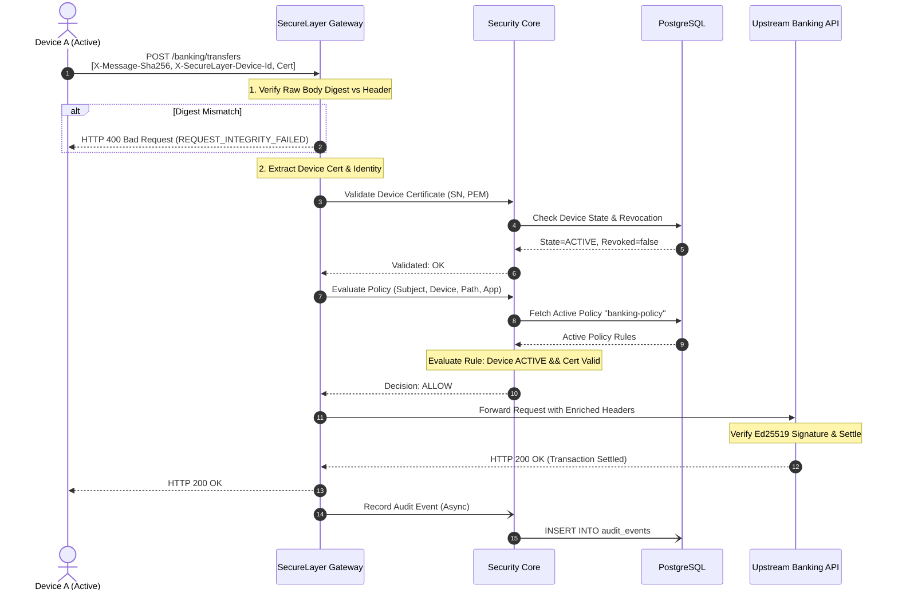

# SecureLayer Architecture Specification

## 1. Architectural Philosophy: Centralized Control Plane, Distributed Enforcement

Traditional monolithic security architectures route all application network traffic through a single central firewall or API security appliance. In large-scale cloud-native environments, this creates catastrophic operational vulnerabilities:
1. **Global Performance Bottleneck:** All throughput is constrained by the compute capacity of the centralized security node.
2. **Blast Radius & Availability Single Point of Failure (SPOF):** An outage in the inspection engine disables all dependent upstream services.
3. **Cross-Service Latency Penalty:** East-West traffic between internal microservices must hairpin through a centralized inspection cluster.

To resolve these defects, **SecureLayer decouples the Control Plane from the Data Plane**.

```
                               ┌────────────────────────────────┐
                               │   CENTRALIZED CONTROL PLANE    │
                               │  (security-core & PostgreSQL)  │
                               │  - Identity & Role Authority   │
                               │  - Device Registration & CA    │
                               │  - Policy Authoring & Version  │
                               │  - Cryptographic Audit Storage │
                               └───────────────┬────────────────┘
                                               │
               ┌───────────────────────────────┴───────────────────────────────┐
               │ Distribution of Policies, Certs, & Keys (REST/gRPC sync)      │
               ▼                                                               ▼
 ┌───────────────────────────┐                                   ┌───────────────────────────┐
 │   DISTRIBUTED GATEWAY A   │                                   │   DISTRIBUTED GATEWAY B   │
 │   (Stateless Data Plane)  │                                   │   (Stateless Data Plane)  │
 ├───────────────────────────┤                                   ├───────────────────────────┤
 │ • Verify X-Message-Sha256 │                                   │ • Verify X-Message-Sha256 │
 │ • Fast Local Policy Cache │                                   │ • Fast Local Policy Cache │
 │ • Validate Client Cert    │                                   │ • Validate Client Cert    │
 │ • Default Fail-Closed     │                                   │ • Default Fail-Closed     │
 └─────────────┬─────────────┘                                   └─────────────┬─────────────┘
               │                                                               │
               ▼                                                               ▼
 ┌───────────────────────────┐                                   ┌───────────────────────────┐
 │ Upstream Microservice A   │                                   │ Upstream Microservice B   │
 └───────────────────────────┘                                   └───────────────────────────┘
```

### Why Centralized Control Plane?
- **Single Source of Truth:** Device revocation, user lifecycle states, policy versions, and tenant configurations must be authoritative and globally consistent.
- **Audit Ledger Integrity:** Audit logs must be consolidated in an append-only relational repository where tampering cannot be orchestrated from a compromised edge proxy.
- **Cryptographic Trust Anchor:** The internal Root and Intermediate Certificate Authorities (CAs) reside strictly within the control plane perimeter, protected by strict RBAC and master encryption keys.

### Why Distributed Data-Plane Enforcement?
- **Horizontal Scalability:** Gateways are completely stateless. Operators can scale from 1 to 1,000 gateway instances behind standard Layer 4 load balancers without shared session state.
- **Microsecond Latency:** Edge gateways evaluate message integrity and cache policy AST evaluations locally in memory or fast local Redis replicas.
- **Fault Isolation:** Even during temporary control plane unavailability, edge gateways continue enforcing cached, active policies in fail-closed mode (`DENY`).

---

## 2. System Components

The SecureLayer platform consists of seven foundational subsystems:

### 2.1. `security-core` (Java 25 / Spring Boot 4.1.1)
The administrative engine and certificate authority:
- **Device Identity Service:** Processes registration challenges, performs proof-of-possession checks, signs X.509 device certificates, and manages CRLs.
- **Policy Engine Service:** Compiles, validates, and evaluates granular policy rules based on subject identity, device state, application authorization, and contextual metadata.
- **Key & Encryption Vault:** Manages symmetric encryption keys and asymmetric signing keys using envelope encryption.
- **gRPC Server:** Exposes high-throughput Protobuf RPCs (`DataPlaneService`, `ControlPlaneService`) on port `9090`.
- **REST Admin API:** Secure management endpoints on port `8090`.

### 2.2. `gateway` (Stateless Reverse Proxy)
The gatekeeper deployed immediately in front of upstream business services:
- **Wire Inspection:** Inspects incoming HTTP/HTTPS headers, extracts device certificates, and re-computes raw body digests (`X-Message-Sha256`).
- **Policy Query:** Evaluates incoming request parameters against the active policy definition (querying `security-core` or local Redis cache).
- **Default-DENY Gate:** Rejects unauthorized, tampered, or certificate-lacking requests prior to invocation of any upstream logic.
- **Header Enrichment:** Enriches approved requests with cryptographic audit headers (`X-SecureLayer-Subject`, `X-SecureLayer-Policy-Decision`) and forwards the payload to the internal application.

### 2.3. SDK Ecosystem (`sdk-node`, `sdk-python`, `sdk-java`)
Developer libraries designed to standardize zero-trust primitives across diverse languages:
- **Unified Interfaces:** `encryptAes256Gcm()`, `decryptAes256Gcm()`, `sha256()`, `signEd25519()`, `verifyEd25519()`.
- **Middleware Hooks:** Spring Boot interceptors, Express/Node middleware, and Python ASGI/WSGI adapters that wrap incoming/outgoing requests with SecureLayer integrity headers automatically.

### 2.4. `dashboard` (Next.js 15 / React 19)
The operations console for cybersecurity teams:
- **Real-Time Visibility:** Live metrics on active devices, blocked access attempts, policy evaluation counts, and integrity failures.
- **Workflows:** Visual wizards for registering applications, enrolling devices, issuing and revoking certificates, and editing policy rules.
- **Audit Explorer:** Searchable, cryptographically validated table of all security events recorded across the platform.

### 2.5. `browser-extension` (Chrome Manifest V3)
Application-layer zero-trust client:
- **Local Key Isolation:** Stores asymmetric device keys in extension-isolated storage, using the browser's native **Web Crypto API**.
- **Access Assertion:** Intercepts navigation to protected corporate resources, retrieves device policy decisions, and injects device authentication tokens into HTTP requests.

### 2.6. `postgres` (Relational Persistence)
The ACID-compliant data store storing:
- `security_tenants`, `identities`, `identity_roles`
- `devices`, `certificates`
- `applications`, `application_scopes`, `application_redirect_uris`
- `security_policies` (versioned JSONB document models)
- `audit_events` (tamper-evident SHA-256 event hashes and signatures)

### 2.7. `redis` (Cache & Session Tier)
In-memory data store for:
- Session tokens and OAuth 2.1 state
- Active device certificate revocation lists (CRL cache)
- High-frequency policy decision caching for high-traffic endpoints

---

## 3. Communication Topologies & Data Flow

### Request Flow: Protected API Invocation



---

## 4. Scalability & Resilience

1. **Gateway Horizontal Scaling:**
   - Stateless operation ensures any gateway can service any request.
   - Session affinity is unnecessary. Round-robin DNS or Layer 4 network load balancing (e.g. AWS NLB, HAProxy) distributes incoming connections evenly.
2. **Policy Evaluation Caching:**
   - Gateways cache positive policy evaluation outcomes in Redis with configurable TTLs (e.g., 60 seconds).
   - In the event of a cache miss or policy invalidation event (broadcast via Redis pub/sub), the gateway fetches the authoritative policy from `security-core`.
3. **Database Read Replicas:**
   - High-throughput environments can direct policy read queries and certificate status checks to PostgreSQL read replicas, reserving the primary instance for registrations and audit ingestion.
4. **Graceful Degradation:**
   - In total network partitions between the gateway and `security-core`, the gateway enforces a configurable **fail-closed** policy, ensuring untrusted traffic never slips through during outages.
