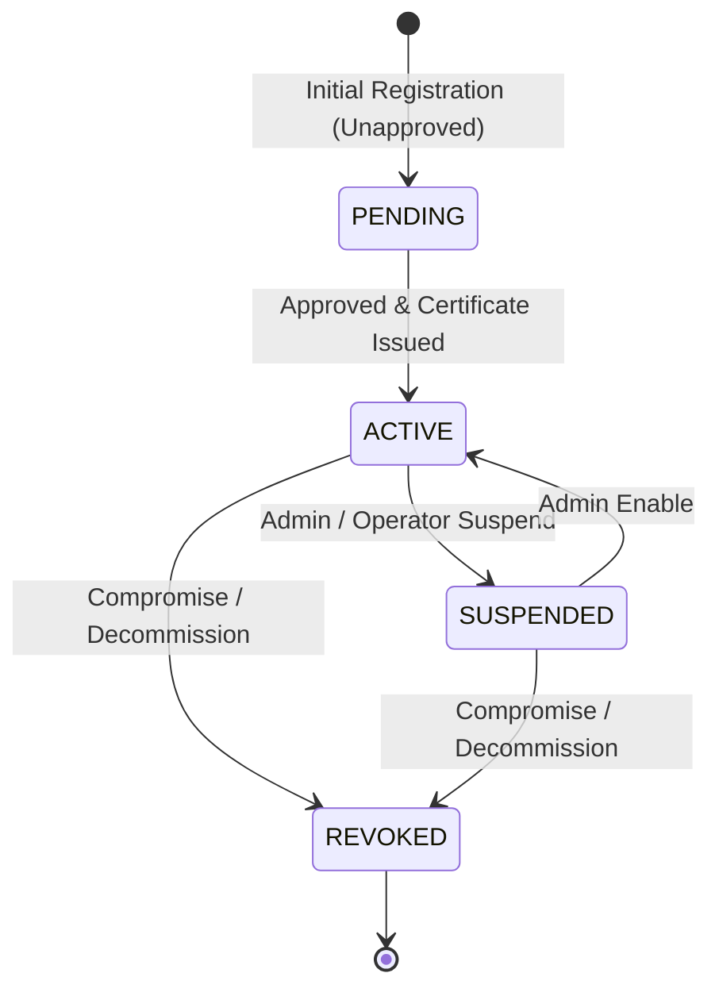

# Device-Bound Identity Architecture

SecureLayer implements cryptographic device-bound identity to eliminate reliance on bearer credentials alone. A request is not trusted merely because a caller possesses a valid username and password; access to protected applications requires cryptographic binding to an authorized, active physical or browser device.

---

## 1. Core Principles

1. **Private Keys Never Leave the Device**:
   - The device generates an asymmetric key pair locally (e.g. Ed25519 or ECDSA P-256 via Web Crypto API or hardware TPM/Secure Enclave).
   - Only a Certificate Signing Request (CSR) containing the public key and proof of possession is transmitted to the server.
   - The server never receives, generates, or persists client private keys.

2. **Server-Side Proof of Possession Verification**:
   - The [`CertificateAuthorityService`](../security-core/src/main/java/com/securelayer/core/service/CertificateAuthorityService.java) parses the PKCS#10 CSR and verifies the self-signature using the embedded public key before signing:
     ```java
     if (!csr.isSignatureValid(new JcaContentVerifierProviderBuilder().setProvider("BC").build(publicKey))) {
         throw new IllegalArgumentException("CSR proof of possession is invalid");
     }
     ```

3. **Cryptographic Identity Binding**:
   - Each registered device receives a unique `UUID` identifier, device identifier, and an X.509 certificate issued by the SecureLayer Device CA (`CN=SecureLayer Device CA,O=SecureLayer`).
   - The certificate is strictly bound to the device's unique SHA-256 public key hash (`publicKeySha256`).

---

## 2. Device Lifecycle & States

Every device transitions through strictly enforced lifecycle states in [`DeviceState`](../security-core/src/main/java/com/securelayer/core/domain/DeviceState.java):



- **`PENDING`**: Device record created, but awaiting administrative approval. Authentication attempts are **`DENIED`**.
- **`ACTIVE`**: Fully approved and issued a valid X.509 certificate. Requests are **`ALLOWED`** subject to policy rules.
- **`SUSPENDED`**: Temporarily disabled by an administrator or security operator. All access attempts are immediately **`DENIED`**, even with a valid certificate.
- **`REVOKED`**: Permanently revoked due to device loss or credential compromise. All active certificates are marked `revoked = true` in PostgreSQL and permanently denied.

---

## 3. Certificate Management Operations

Implemented in [`DeviceIdentityService`](../security-core/src/main/java/com/securelayer/core/service/DeviceIdentityService.java):

1. **Device Registration (`register`)**:
   - Accepts device name, identifier, and PKCS#10 CSR PEM.
   - Verifies proof of possession.
   - Issues 90-day X.509 certificate signed by SecureLayer CA.
   - Persists [`CertificateRecord`](../security-core/src/main/java/com/securelayer/core/domain/CertificateRecord.java) and creates `DEVICE_REGISTERED` + `DEVICE_CERTIFICATE_ISSUED` audit events.

2. **Certificate Validation (`validateCertificate` / `authenticate`)**:
   - Validates that the certificate was issued by SecureLayer.
   - Compares current time against certificate validity window (`notBefore` to `notAfter`).
   - Confirms `revoked == false`.
   - Confirms the presenting device is in `ACTIVE` state.
   - Confirms the certificate public key matches the registered device's `publicKeySha256`.

3. **Certificate Expiration**:
   - Evaluated automatically against UTC clock. Expired certificates return `authenticated: false` and trigger `DEVICE_AUTHENTICATION_FAILED` audit records.

4. **Certificate Revocation (`revokeCertificate`)**:
   - Marks certificate as revoked in database (`revoked = true`) and emits `DEVICE_CERTIFICATE_REVOKED` audit event.

5. **Device Disable / Enable (`suspend` / `enable`)**:
   - `suspend`: Changes state to `SUSPENDED`, audits `DEVICE_SUSPENDED`.
   - `enable`: Changes state to `ACTIVE`, audits `DEVICE_ENABLED`.

6. **Certificate Rotation (`rotateCertificate`)**:
   - Only permitted when device is `ACTIVE`.
   - Automatically revokes previously active certificates for the device.
   - Verifies the new CSR uses the registered device public key.
   - Issues and returns new certificate, auditing `DEVICE_CERTIFICATE_ROTATED`.

---

## 4. Policy Enforcement: Registered Device Requirement

The [`PolicyEngineService`](../security-core/src/main/java/com/securelayer/core/service/PolicyEngineService.java) enforces device-bound policies without hardcoding application logic:

```json
{
  "rules": [
    {
      "effect": "ALLOW",
      "conditions": {
        "resource": "/banking/**",
        "application": { "approved": true },
        "device": { "registered": true, "state": "ACTIVE" },
        "certificate": { "required": true, "valid": true }
      },
      "reason": "Access allowed: caller is authenticated with registered ACTIVE device."
    },
    {
      "effect": "DENY",
      "conditions": {
        "resource": "/banking/**"
      },
      "reason": "Access denied: caller does not present a registered ACTIVE device."
    }
  ]
}
```

If a user presents valid user credentials but the device is unapproved (`PENDING`), disabled (`SUSPENDED`), revoked (`REVOKED`), or missing a valid certificate, the request is blocked at the Gateway with **`HTTP 403 DENIED`** and recorded to the audit trail.
